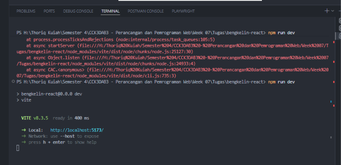
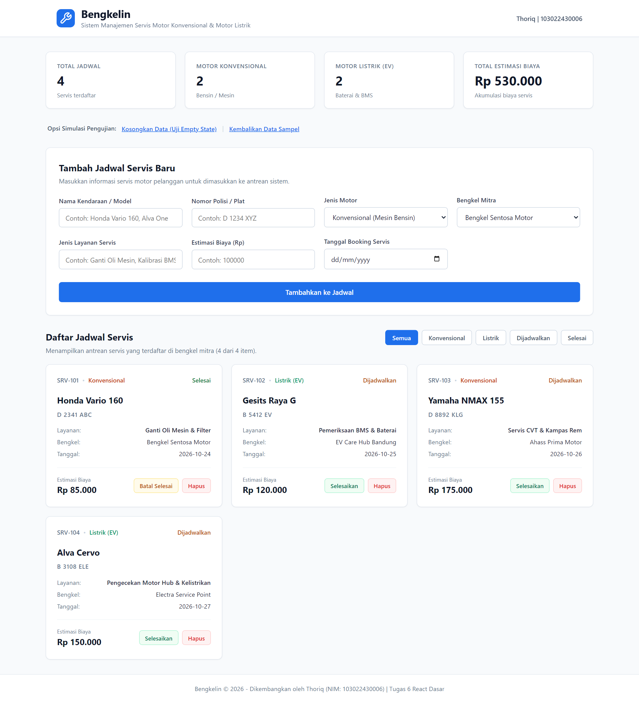
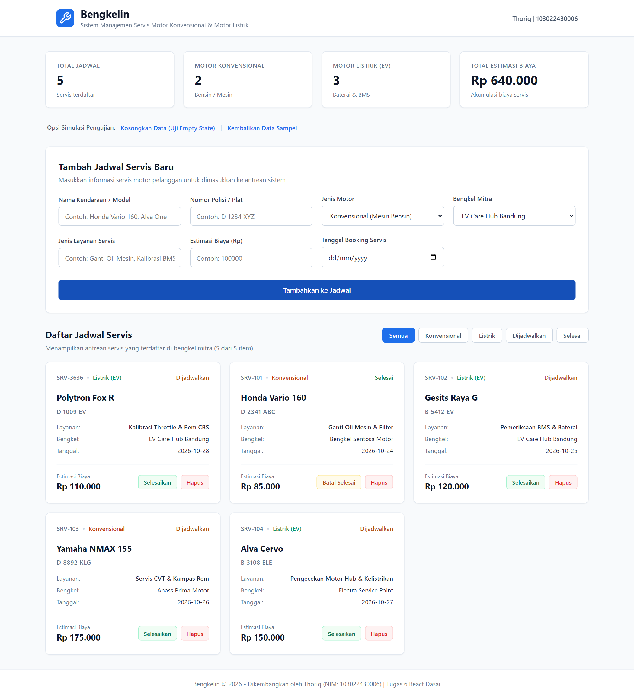
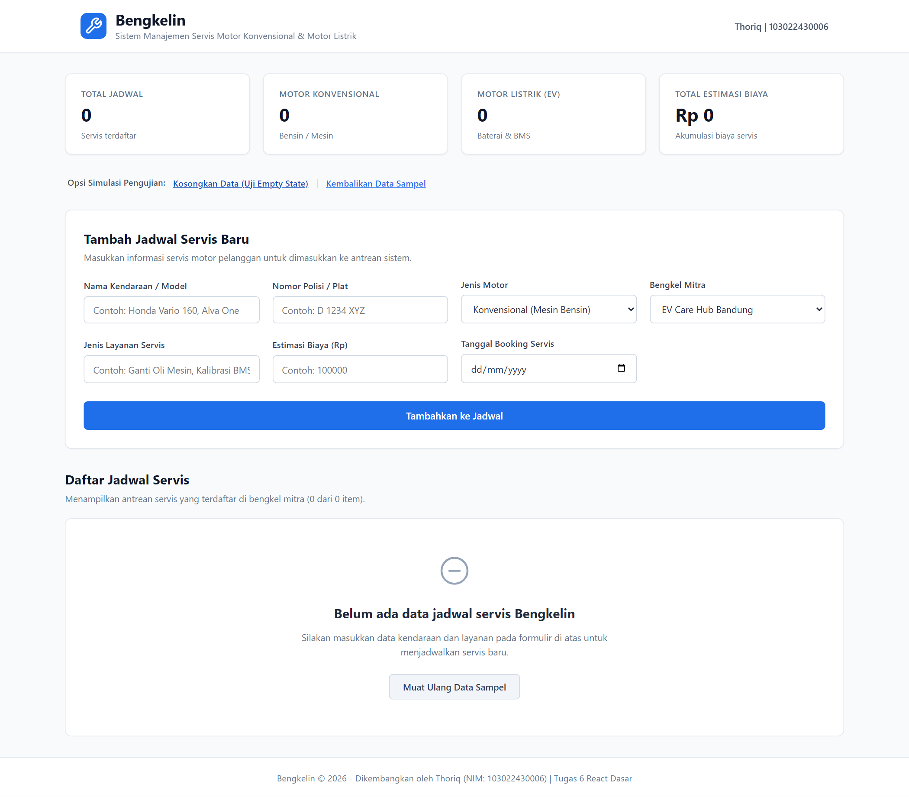

# Bengkelin - Frontend React (Vite)

AI Usage:

Buat dokumen README, menggunakan gemini.com

koding menggunakan VS code code complition

Aplikasi web modern untuk manajemen booking jadwal dan riwayat servis motor (konvensional & motor listrik). Proyek ini merupakan kelanjutan dari proyek Bengkelin pada pekan-pekan sebelumnya yang kini ditransformasikan menjadi *Single Page Application* (SPA) berbasis **React** dan **Vite** untuk memenuhi penugasan **Tugas 6 (React Dasar)** pada mata kuliah **Perancangan dan Pemrograman Web (Week 07)**.

---

## Informasi Mahasiswa

- **Nama:** Thoriq
- **NIM:** 103022430006
- **Mata Kuliah:** Perancangan dan Pemrograman Web (CCK3DAB3)
- **Tugas:** Week 07 - Tugas 6 React Dasar

---

## Fitur Utama (Pekan 7 - React Dasar)

1. **Arsitektur Komponen Modular**:
   - `Header.jsx`: Identitas brand dan status navigasi aplikasi.
   - `RingkasanStatistik.jsx`: Ringkasan metrik (Total Jadwal Servis, Servis Motor Listrik, Servis Konvensional, dan Total Estimasi Biaya).
   - `FormTambahServis.jsx`: *Controlled component form* untuk input jadwal servis baru lengkap dengan validasi.
   - `DaftarServis.jsx`: Wadah rendering daftar servis menggunakan `.map()` dengan *unique key* dan *conditional rendering* saat daftar kosong.
   - `KartuServis.jsx`: Komponen kartu detail servis berbasis *props* dengan pembedaan badge tipe kendaraan dan tombol interaksi.
2. **State Management**:
   - Menggunakan React State (`useState`) terpusat pada `App.jsx` (*state lifting*).
   - Penambahan data interaktif tanpa *page reload*.
   - Filter dan penghapusan data secara reaktif.
3. **User-Centered Design**:
   - Tampilan responsif, modern, dan informatif dengan pemformatan mata uang Rupiah dan penanda visual kategori kendaraan.

---

## Teknologi yang Digunakan

- **React 19**
- **Vite 8**
- **Vanilla CSS (Modern Flexbox & Grid, CSS Custom Properties)**

---

## Panduan Menjalankan Proyek Secara Lokal

1. **Clone repositori**:

   ```bash
   git clone https://github.com/Thbetyfu/TUGAS-PENGWEB-MULAI_WEEK-07.git
   cd TUGAS-PENGWEB-MULAI_WEEK-07
   ```
2. **Instal dependensi**:

   ```bash
   npm install
   ```
3. **Jalankan development server**:

   ```bash
   npm run dev
   ```
4. **Akses aplikasi**:
   Buka browser dan arahkan ke:

   ```
   http://localhost:5173
   ```
5. **Build untuk production**:

   ```bash
   npm run build
   ```

---

## Dokumentasi & Tangkapan Layar Aplikasi

### 1. Terminal Development Server (localhost:5173)



### 2. Tampilan Halaman Utama & Komponen Modular



### 3. Penambahan Data Baru via Controlled Form



### 4. Implementasi Conditional Rendering (Data Kosong)


